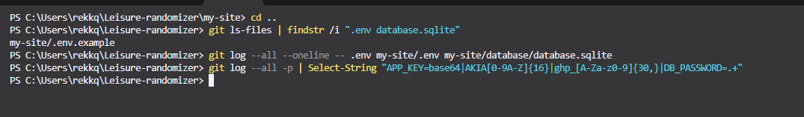
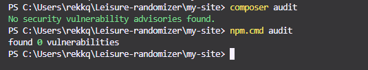
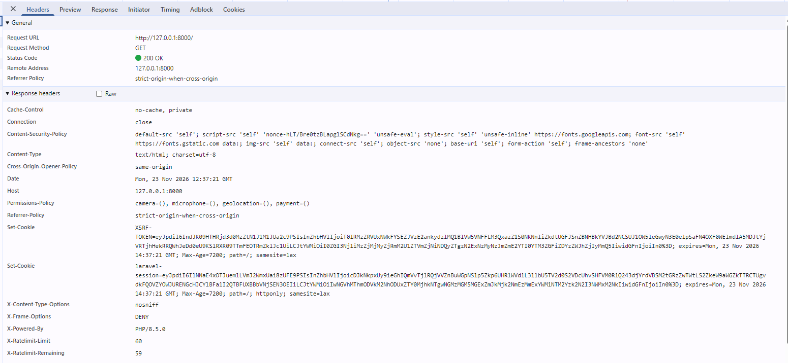
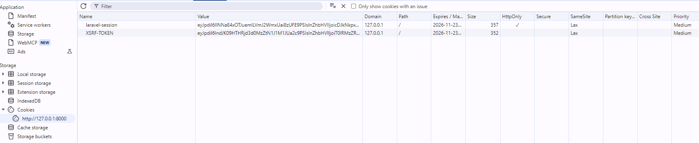

# config-check.md — конфигурация: секреты, зависимости, HTTPS, заголовки, CSRF, куки (команда 4, «Рандомайзер досуга»)

Стек: Laravel 13 (PHP 8.3+), Blade, Laravel Breeze, SQLite, Tailwind CSS, Alpine.js, Vite.


## 1. Секреты

| Проверка | Результат | Где |
|---|---|---|
| `.env` не попадает в репозиторий | В `.gitignore` есть `.env`, `.env.backup`, `.env.production`, `/auth.json`, `/storage/*.key` | `my-site/.gitignore` |
| В репозитории лежит только образец `.env.example` | Да. `APP_KEY=` пустой, ключи AWS пустые, пароли `null`, реальных значений нет | `my-site/.env.example` |
| Файл базы не в репозитории | `database/.gitignore` содержит `*.sqlite*` | `my-site/database/.gitignore` |
| Секретов нет в коде | В `app`, `config`, `routes`, `database`, `resources`, `tests` нет вшитых паролей, ключей и токенов; все настройки читаются из `.env` через `env()` | — |
| Автотест | `test_env_example_has_no_real_secrets`, `test_env_file_is_in_gitignore` | `tests/Feature/ConfigSecurityTest.php` |

**Поиск забытых ключей по истории git** (команды выполнены в PowerShell из корня репозитория, результат — пусто, то есть ничего не найдено):

```
git ls-files | findstr /i ".env database.sqlite"
git log --all --oneline -- .env my-site/.env my-site/database/database.sqlite
git log --all -p | Select-String "APP_KEY=base64|AKIA[0-9A-Z]{16}|ghp_[A-Za-z0-9]{30,}|DB_PASSWORD=.+"
```

Что ожидаем: первая команда показывает только `my-site/.env.example`; вторая и третья ничего не выводят.



Если бы ключ нашёлся: считаем его скомпрометированным, выпускаем новый (`php artisan key:generate`), старый отзываем; историю чистим отдельной задачей (мы уже делали это для картинки `xss-admin.png`).

## 2. Зависимости

Всего зафиксировано (по `composer.lock` и `package-lock.json`): PHP — 111 пакетов (77 рабочих и 34 для разработки), JS — 219 пакетов. Ниже только прямые зависимости (их мы выбирали сами).

**PHP (composer):**

| Пакет | Требование | Установлено | Для чего |
|---|---|---|---|
| php | ^8.3 | — | язык |
| laravel/framework | ^13.17 | v13.38.0 | сам фреймворк |
| laravel/tinker | ^3.0 | v3.0.2 | консоль для экспериментов |
| laravel/breeze *(dev)* | ^2.4 | v2.4.2 | вход, регистрация, профиль |
| fakerphp/faker *(dev)* | ^1.23 | v1.24.1 | тестовые данные |
| laravel/pail *(dev)* | ^1.2.5 | v1.2.7 | просмотр логов |
| laravel/pao *(dev)* | ^1.0.6 | v1.1.5 | служебный пакет Laravel |
| laravel/pint *(dev)* | ^1.27 | v1.32.1 | автоформатирование кода |
| mockery/mockery *(dev)* | ^1.6 | 1.6.15 | заглушки в тестах |
| nunomaduro/collision *(dev)* | ^8.6 | v8.9.5 | красивый вывод ошибок |
| phpunit/phpunit *(dev)* | ^12.5.12 | 12.5.40 | автотесты |

**JS (npm), все в `devDependencies`, то есть нужны только для сборки, на сервер не попадают:**

| Пакет | Требование | Установлено |
|---|---|---|
| tailwindcss | ^3.1.0 | 3.4.19 |
| @tailwindcss/forms | ^0.5.2 | 0.5.11 |
| @tailwindcss/vite | ^4.0.0 | 4.3.3 |
| alpinejs | ^3.4.2 | 3.17.5 |
| vite | ^8.0.0 | 8.3.5 |
| laravel-vite-plugin | ^3.1 | 3.2.0 |
| postcss | ^8.4.31 | 8.5.31 |
| autoprefixer | ^10.4.2 | 10.6.1 |
| concurrently | ^10.0.3 | 10.0.6 |

Наблюдения по составу (взяты в задачи):
- `@tailwindcss/vite` (версия 4) указан в `package.json`, но в `vite.config.js` не подключён: Tailwind работает через PostCSS (версия 3). Лишняя зависимость, её нужно убрать.
- Шрифты загружаются с `fonts.googleapis.com` / `fonts.gstatic.com`: внешний источник; в CSP он разрешён явно. План: положить шрифты в проект и убрать внешний домен.

**Проверка уязвимостей** (выполнено в папке `my-site`):

```
composer audit
npm audit
composer outdated --direct
npm outdated
```

Результат `composer audit` **до обновления** (дата проверки 23.11.2026): найдено 8 уведомлений в 5 пакетах.

| Пакет | Уровень | Идентификатор | Суть |
|---|---|---|---|
| `laravel/framework` | low | CVE-2026-128083 (GHSA-63hm-g96r-2m2q) | внедрение вывода в `Concurrency`; исправлено |
| `symfony/http-foundation` | не указан | CVE-2026-121619 | `private_ranges` доверяет клиентам с адресами IPv4-mapped, 6to4, Teredo, NAT64 как прокси |
| `symfony/http-foundation` | не указан | CVE-2026-118514 | HEAD-запросы обходят `methods` в `access_control` |
| `symfony/http-foundation` | не указан | PKSA-pr6q-2w5s-kzzf | обход правил по пути добавлением пути к имени скрипта |
| `symfony/http-foundation` | не указан | PKSA-b2gg-vk1g-6d5q (GHSA-5mx8-mwrp-5693) | сгенерированные URL могут указывать на хост, выбранный клиентом |
| `symfony/http-kernel` | не указан | CVE-2026-123339 | недоверенные заголовки `Forwarded` задают хост, схему и порт URL |
| `symfony/mime` | medium | CVE-2026-45070 | внедрение заголовков письма через символы в именах параметров MIME |
| `symfony/routing` | не указан | CVE-2026-118516 | плейсхолдеры хоста могут совпасть с началом пути, обход контроля доступа по пути |

Результат `composer audit` **после** `composer update`:

```
No security vulnerability advisories found.
```

Результат `npm audit`:

```
found 0 vulnerabilities
```



**Что обновили:** выполнили `composer update laravel/framework symfony/http-foundation symfony/http-kernel symfony/mime symfony/routing` (`laravel/framework` до 13.40.0 или новее, пакеты Symfony до 7.4.23 / 8.1.11 или новее). После обновления `composer audit` не находит уязвимостей, `php artisan test` проходит. Изменился только `composer.lock`. В npm обновлять нечего.

**На что завели задачу:** убрать неиспользуемый `@tailwindcss/vite`; перенести шрифты в проект и убрать Google Fonts из CSP; перейти на `@alpinejs/csp` и убрать `unsafe-eval`; запускать `composer audit` и `npm audit` перед каждой сдачей и после каждого `composer update`; отключить `expose_php` в `php.ini` на сервере; перед выкладкой настроить доверенные прокси (`TrustProxies`) и `APP_URL`.

### Самая опасная находка аудита зависимостей

Самой опасной считаем находки в `symfony/http-foundation` и `symfony/http-kernel`: «Generated URLs Can Point to a Host Chosen by the Client» (GHSA-5mx8-mwrp-5693) и CVE-2026-123339 (недоверенные заголовки `Forwarded` задают хост, схему и порт). Из-за них адреса, которые сайт строит сам, например ссылка в письме сброса пароля, может подменить клиент через заголовок `Host`. Тогда жертва получит письмо со ссылкой на домен злоумышленника, и токен сброса пароля попадёт к нему. Эти пакеты рабочие (`require`, не только для разработки) и обрабатывают каждый запрос, поэтому уязвимость достижима у нас: в проекте есть регистрация, вход и сброс пароля. Остальные находки менее опасны для нас: `laravel/framework` (low) касается `Concurrency`, которую мы не используем; `symfony/mime` (medium) касается писем, а у нас `MAIL_MAILER=log`; находки про `access_control` и обход по пути относятся к Symfony Security, а доступ администратора у нас проверяет Laravel-middleware `admin`. Все 8 находок закрыли обновлением, повторный `composer audit` чистый.

## 3. HTTPS и заголовки ответа

Заголовки выставляет один файл, `app/Http/Middleware/SecurityHeaders.php`, он подключён ко всем ответам в `bootstrap/app.php`.

| Заголовок | Значение | От чего защищает |
|---|---|---|
| Content-Security-Policy | `default-src 'self'; script-src 'self' 'nonce-…' 'unsafe-eval'; style-src 'self' 'unsafe-inline' https://fonts.googleapis.com; font-src 'self' https://fonts.gstatic.com data:; img-src 'self' data:; connect-src 'self'; object-src 'none'; base-uri 'self'; form-action 'self'; frame-ancestors 'none'` | XSS: браузер запускает только свои скрипты и скрипты с одноразовым `nonce`, чужие и вставленные не запустит; запрещены плагины, подмена `<base>`, отправка форм на чужой адрес |
| X-Frame-Options | `DENY` | Clickjacking: сайт нельзя встроить в чужую страницу (то же в CSP через `frame-ancestors 'none'`) |
| X-Content-Type-Options | `nosniff` | Браузер не «угадывает» тип файла (скрипт под видом картинки) |
| Referrer-Policy | `strict-origin-when-cross-origin` | На чужие сайты уходит только адрес сайта, без путей и параметров |
| Permissions-Policy | `camera=(), microphone=(), geolocation=(), payment=()` | Страница не может запросить камеру, микрофон, геолокацию, платежи |
| Cross-Origin-Opener-Policy | `same-origin` | Чужие окна не получают доступ к нашему окну |
| Strict-Transport-Security | `max-age=31536000; includeSubDomains` | «Открывай сайт только по https» (год). **Отправляется только по https** |

**HTTPS.** Локально сайт работает по http (`php artisan serve`), поэтому HSTS на скриншоте локального ответа не будет: по http его отправлять нельзя, он ничего не даёт, а на `localhost` мог бы мешать. Что сделано для сервера: в `AppServiceProvider` при `APP_ENV=production` включён `URL::forceScheme('https')` (все ссылки и редиректы строятся по https), по умолчанию в этом режиме включается `Secure` у cookie (`config/session.php`), HSTS включается автоматически по https. Что делает автотест: `test_hsts_only_over_https` проверяет, что по http заголовка нет, а по https он есть.

**Что пришлось поправить из-за CSP.** Политика запрещает код прямо в атрибутах (`onclick=`, `onsubmit=`, `onmouseover=`), поэтому: кнопки «Выйти» и подтверждение очистки истории переписаны на Alpine (`x-on:click`, `x-on:submit`), у кнопок «Одобрить» и «Отклонить» в админке inline-стили заменены Tailwind-классами, а наши три inline-скрипта получили `nonce`. Автотест `test_views_have_no_inline_event_handlers` не даст вернуть их обратно.

**Известные слабые места политики (в задачи):** `'unsafe-eval'` в `script-src` нужен Alpine.js; план: перейти на сборку `@alpinejs/csp`. `'unsafe-inline'` в `style-src` нужен для атрибутов `style` и для Alpine (`x-show`). Внешний домен Google Fonts, убрать после переноса шрифтов в проект.



## 4. CSRF

| Проверка | Результат |
|---|---|
| Защита включена | Стандартное middleware Laravel для проверки CSRF-токена работает на всех POST/PUT/PATCH/DELETE. В `bootstrap/app.php` исключений нет (тест `test_csrf_protection_is_not_switched_off`) |
| Токены на формах | Во всех формах, меняющих данные, есть `@csrf`: 18 форм в 14 файлах (вход, регистрация, сброс и смена пароля, подтверждение пароля, выход ×2, профиль ×2, удаление аккаунта, «Предложить идею», избранное, очистка истории, «Одобрить», «Отклонить», подтверждение email ×2). Формы с методом GET (случайное занятие, каталог, фильтры) ничего не меняют и токена не требуют. Тест `test_every_state_changing_form_has_csrf_token` сканирует все шаблоны |
| SameSite у cookie | `lax` (`SESSION_SAME_SITE=lax`, значение по умолчанию в `config/session.php`): браузер не отправляет cookie сессии с POST-запросов с чужих сайтов |
| Запрос без токена | Сервер отвечает **419 Page Expired** |

## 5. Куки сессий

| Cookie | HttpOnly | Secure | SameSite | Комментарий |
|---|---|---|---|---|
| `laravel-session` (сессия) | да | на сервере да (`SESSION_SECURE_COOKIE=true` или `APP_ENV=production`); локально по http нет | `lax` | скрипт на странице cookie сессии прочитать не может |
| `XSRF-TOKEN` (токен для запросов из JS) | нет, так задумано: его должен читать JS | как у сессии | `lax` | сам по себе не даёт доступ, нужна и cookie сессии |

Остальное: сессии хранятся в базе (`SESSION_DRIVER=database`), срок жизни 120 минут, после входа выдаётся новый идентификатор сессии (`session()->regenerate()`). Настройки: `config/session.php` и блок `SESSION_*` в `.env.example`. Автотесты: `test_session_cookie_is_httponly_and_samesite`, `test_session_config_is_safe`.



## 6. Другое по конфигурации

- В `.env.example` оставлен `APP_DEBUG=true`, он нужен только для работы на своём компьютере; на сервере обязательно `APP_ENV=production` и `APP_DEBUG=false` (комментарий в файле).
- Заголовок `X-Powered-By: PHP/8.5.0` добавляет сам PHP, а не Laravel; на сервере отключаем через `expose_php = Off` в `php.ini` (задача).
- Письма пока пишутся в лог (`MAIL_MAILER=log`), реальные почтовые пароли в проект не вносились.
- Если сайт будет за прокси (nginx и т. п.), нужно будет настроить доверенные прокси, иначе Laravel не увидит, что соединение было по https.

## 7. Тесты

Файл `tests/Feature/ConfigSecurityTest.php` (заголовки, CSP и nonce, HSTS, cookie, CSRF, inline-обработчики, секреты).
Вывод `php artisan test`:

```
Tests:    83 passed (401 assertions)
Duration: 2.85s

(в том числе все 11 тестов ConfigSecurityTest: PASS)
```
